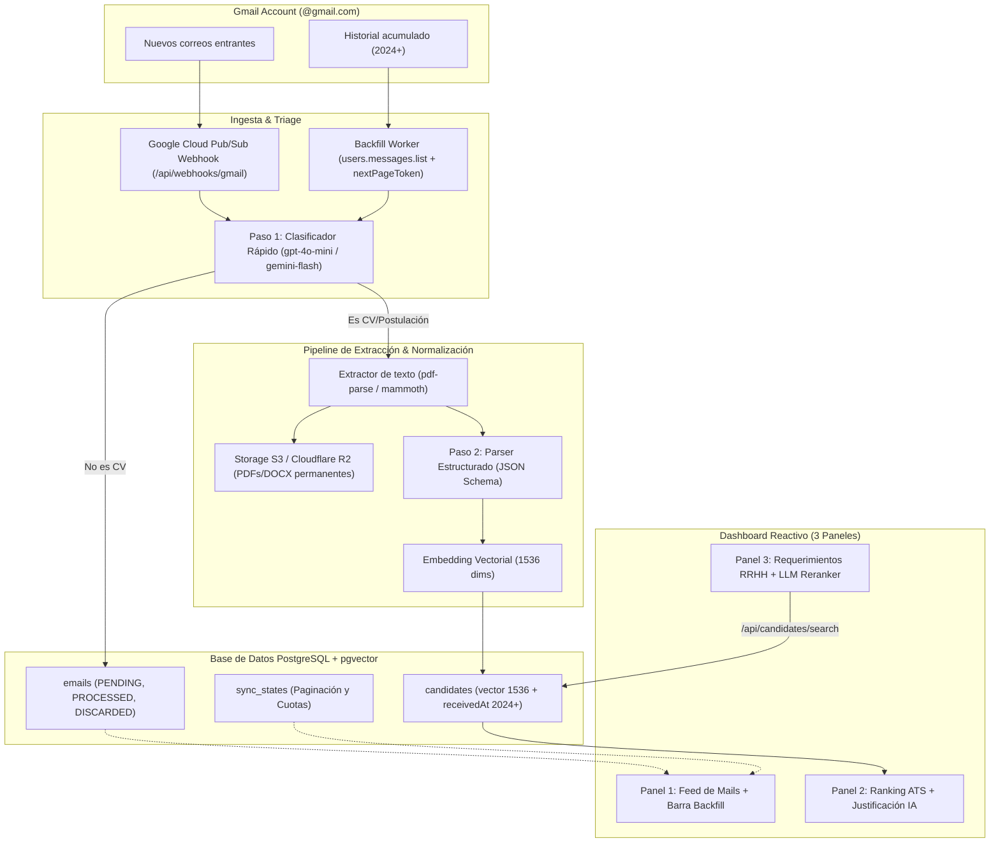

# RRHH ELIZA — Intelligent ATS (Applicant Tracking System)

Sistema ATS empresarial conectado a Gmail API con soporte para **ingesta histórica completa (Backfill 2024+)**, sincronización push en tiempo real mediante **Google Cloud Pub/Sub**, extracción inteligente de currículums estructurados con **LLMs**, indexación semántica en **PostgreSQL con pgvector (1536 dimensiones)** y una interfaz reactiva de **3 paneles**.

---

## 🏛 Arquitectura del Sistema



---

## 🚀 Características Principales

### 1. Ingesta Histórica Completa (Backfill Worker)
- **Paginación resiliente:** Itera hacia atrás mediante `users.messages.list` con `nextPageToken`.
- **Persistencia de estado:** Guarda el puntero de paginación (`nextPageToken`, `historyId`, `totalScanned`, `totalResumesFound`) en la tabla `sync_states`.
- **Deduplicación:** Clave única `gmailMessageId` para evitar descargas o procesamiento redundante.
- **Control de concurrencia y límites:** Lotes controlados (5-10 correos) con delay y backoff exponencial ante respuestas HTTP 429 (`quotaExceeded`).

### 2. Escucha en Tiempo Real (Push Pub/Sub)
- Endpoint `/api/webhooks/gmail` configurado para notificaciones push de Google Cloud Pub/Sub.
- Consulta incremental con `users.history.list` a partir del último `historyId` para procesar postulaciones entrantes en milisegundos.

### 3. Pipeline de Procesamiento de Correo en 2 Pasos
- **Paso 1 (Clasificador económico):** Filtra rápidamente correos que no sean postulaciones (transaccionales, spam, newsletters). Se guardan como `DISCARDED` para no consumir tokens innecesarios.
- **Paso 2 (Extracción estructurada & Storage):**
  - Almacena el PDF/DOCX en storage S3-compatible (Cloudflare R2 o Supabase).
  - Extrae el texto con `pdf-parse` o `mammoth`.
  - Normaliza los datos mediante LLM con JSON Schema: `fullName`, `contactEmail`, `phone`, `location`, `yearsOfExperience`, `seniority`, `languages` (con nivel), `skills` (array), `workHistory`, `education` y `summary`.
  - Genera un embedding vectorial de 1536 dimensiones (`text-embedding-3-small` o Gemini) y guarda el candidato manteniendo la fecha original `receivedAt` (ej. 2024).

### 4. Interfaz de 3 Paneles en Tiempo Real
- **Panel 1 (Izquierdo):** Barra de progreso del escaneo histórico en vivo (`1,420 mails revisados - 310 CVs encontrados`), feed de correos ordenados por fecha, filtros por estado (`CV Procesado`, `Analizando`, `No es CV`).
- **Panel 2 (Central):** Ranking ATS de candidatos según la búsqueda activa (incluyendo tanto recientes como acumulados desde 2024). Incluye badge de match (`0-100%`), fecha histórica ("Enviado en Oct 2024"), justificación de ajuste generada por IA y modal con visor de PDF integrado.
- **Panel 3 (Derecho):** Formulario donde el reclutador redacta requerimientos en lenguaje natural, filtros por seniority, experiencia mínima, switch de históricos y botón para ejecutar búsqueda semántica vectorial + re-ranking LLM sobre los top 30 candidatos.

---

## 🛠 Instalación y Configuración

### 1. Variables de Entorno
Copia `.env.example` a `.env` y completa las credenciales:
```bash
cp .env.example .env
```

Configuraciones esenciales:
- `DATABASE_URL`: Cadena de conexión PostgreSQL (con soporte para extensión `vector`).
- `GOOGLE_CLIENT_ID`, `GOOGLE_CLIENT_SECRET`, `GOOGLE_REDIRECT_URI`: Credenciales OAuth 2.0.
- `AI_PROVIDER`: `"openai"` o `"gemini"`.
- `OPENAI_API_KEY` o `GEMINI_API_KEY`.
- `STORAGE_PROVIDER`: `"s3"`, `"r2"`, `"supabase"` o `"local"`.

### 2. Generar Cliente Prisma
```bash
npx prisma generate
```

Para aplicar el esquema a tu base de datos PostgreSQL:
```bash
npx prisma db push
```

### 3. Ejecutar en Modo Desarrollo
```bash
npm run dev
```
Abre [http://localhost:3000](http://localhost:3000) en el navegador.

---

## 🧪 Pruebas y Modo Demo
Si aún no has conectado una cuenta real de Gmail o base de datos externa, puedes hacer clic en el botón superior **"Demo 2024+"** para sembrar datos simulados con candidatos históricos y correos de prueba, permitiendo evaluar de inmediato la búsqueda semántica y el re-ranking de IA.
"# Eliza-RRHH" 
